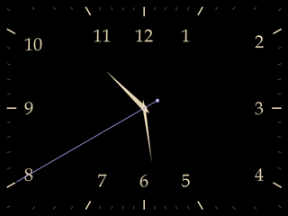
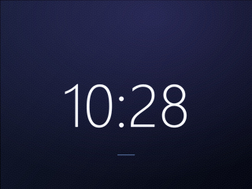
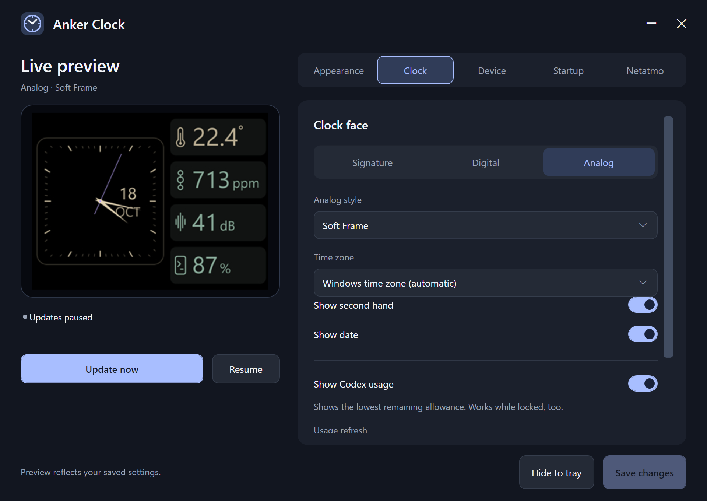

# Anker Clock

A lightweight Windows tray app that puts a clock on the display of the
[Anker A210C desktop USB-C hub](https://www.anker.com/products/a210c-10-in-1-desktop-usb-c-hub-dual-4k-smart-display).





## What it does

- Analog and digital clocks with adjustable fonts, sizes, colors, and time zone.
- Gradient backgrounds, your own images, or pure black. Gradient smoothing reduces visible banding.
- A configurable refresh interval, every 10 seconds by default.
- A lock screen showing when Windows was locked and how many minutes have passed.
- Optional Codex usage, automatic start with Windows, and pause on battery.



## Download and run

[Download the latest Windows release](https://github.com/serhii-rieznik/anker-gpt-clock/releases/latest).

Requires Windows 10 or 11 (x64) and .NET Framework 4.8.

1. Extract the ZIP, keep its files together, and connect the hub by USB.
2. Launch `AnkerClock.exe`.
3. Open settings from the tray icon, customize your clock, and click **Save changes**.

Anker Dock Manager is not required. Close it if it is running so the two apps
do not compete for the display. The hub fades between images.

The app replaces the current image and keeps your other saved photos.
Enabling **Use the gallery only for this clock** clears the gallery when connecting.

## Codex usage

Install and sign in to the Codex CLI or desktop app, then enable **Show Codex usage**.
It shows your remaining allowance on the analog clock and lock screen, refreshing
once a minute by default. If your account has multiple limits, it shows the lowest
remaining percentage. Unavailable readings stay hidden.

## Build

Install Visual Studio 2022 with **Desktop development with C++** and a Windows SDK,
the **.NET Framework 4.8 targeting pack**, .NET SDK 8 or newer, and CMake 3.25 or newer.
From the source folder:

```powershell
cmake --preset windows-vs2022
cmake --build --preset release-vs2022
cmake --install build/vs2022 --config Release --prefix dist
```

The runnable app is in `dist/`.

## License

[MIT](LICENSE). This is an independent project, unaffiliated with Anker or OpenAI.
